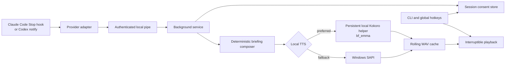

# Architecture and data flow

BLAIR is a small local event pipeline. Agent-specific code ends at the adapter;
briefing composition, consent, speech, playback, and controls are provider-neutral.



No microphone or speech-recognition component exists in this graph. Win+H, when
used, belongs to Windows and is outside BLAIR.

## Component boundaries

### Provider adapters

Adapters validate a bounded provider payload and produce a `NormalizedEvent` with
an event ID, provider, provider session ID, final assistant text, event name,
working directory, and limited metadata.

- Codex accepts only `agent-turn-complete` notifications and uses the stable
  `thread-id` plus `turn-id` as its event identity.
- Claude accepts `Stop` and `StopFailure`. A Stop event supplies the final
  assistant message; a failure event is normalized into an explicit failure.
- The generic adapter exists for fixtures and future integrations.

Unsupported or malformed events are recorded as content-light diagnostics and the
hook returns success. BLAIR must never break the parent agent.

### Hook entry point and local service

The provider hook parses its payload, connects to an authenticated local IPC
endpoint, and enqueues the event synchronously. It waits only for local queue
acceptance, never for synthesis or playback. If the service is absent, the hook
starts it and retries briefly. Every exception is caught so the provider still
receives a successful hook exit.

On Windows the endpoint is a named pipe derived from the resolved BLAIR home. A
random 32-byte authentication key is stored in the runtime directory. The service
serializes synthesis and playback so two completions do not talk over each other.

The queue is **latest-wins**: a newly received completion stops current playback,
discards an older queued completion, and becomes the next briefing. Duplicate
event IDs or identical provider/session/text events within the deduplication
window are suppressed.

### Session and consent state

`sessions.json` is an atomic, lock-protected store. Each provider session records
its provider, working directory, tri-state consent, last briefing, and last WAV
path. CLI commands can target an exact session; commands and hotkeys without a
session target the most recently active one.

Consent can come from the `blair run` terminal question or, for an unseen session
whose hook fires outside the wrapper, a Windows Yes/No dialog. Each wrapper process
has a random launch ID: its selection is applied once on the first completion and
manual toggles then persist. A declined session is normalized but does not proceed
to briefing composition or TTS.

### Deterministic composer

The composer performs no model call. It:

1. removes ANSI sequences, Markdown noise, code blocks, diffs, and table rows;
2. replaces common secrets, URLs, paths, and long identifiers;
3. classifies the response as success, partial, blocked, or neutral;
4. scores existing sentences for outcomes, changes, verification, and attention;
5. adds a screen-detail cue for omitted code or tables;
6. applies the configured word limit.

An optional `<blair_brief>...</blair_brief>` region can supply a concise source,
but it still passes through cleaning and redaction. The composer does not invent
test results or use agent text as executable control input.

### Speech and playback

Backend selection in `auto` mode is:

1. verified Kokoro model plus installed optional `kokoro-onnx` dependencies;
2. built-in Windows SAPI;
3. a clear error if neither local backend is available.

Kokoro defaults to `bf_emma`, `en-gb`, and speed `1.03`. SAPI selects an installed
English (United Kingdom) female voice where available, otherwise its default.
Both backends write a WAV before playback. Playback runs in a child process so
`blair stop` and the stop hotkey can interrupt it.

The main service never imports the optional neural runtime. It sends one job at a
time over a private JSON-lines pipe to a persistent child process launched with
the same local Python interpreter. The child removes caller-controlled native
library/provider environment overrides, loads the verified local model once, and
atomically encodes mono PCM16 WAV files using NumPy and Python's standard `wave`
module. It contains no download or network code. If the pipe fails, BLAIR replaces
the child and retries once; synthesis errors remain local and never fail an agent
hook. Keeping the worker warm avoids reloading the 326 MB model after every turn.

Kokoro's phonemizer stack has separate license obligations and is never included
in BLAIR's Apache-2.0 core artifact. See
[third-party-licenses.md](third-party-licenses.md).

## Persistence

The default data root is `%LOCALAPPDATA%\BLAIR`:

```text
BLAIR/
├── config.json
├── sessions.json
├── playback.json              # present only around playback
├── audio/                     # rolling WAV cache
├── models/kokoro/             # optional verified model cache
├── logs/blair.log             # operational metadata/errors
└── runtime/                   # daemon metadata, locks, key, hashes
```

See [PRIVACY.md](../PRIVACY.md) for exact fields and deletion instructions.

## Integration changes

`blair install` is an explicit, reversible operation:

- Codex receives one marked top-level `notify` block. Installation refuses if an
  unrelated notify command already exists.
- Claude receives BLAIR hook groups appended to `Stop` and `StopFailure`; unrelated
  hooks and settings remain intact.
- Existing files receive timestamped backups before an atomic write.
- `blair uninstall` removes only BLAIR-managed entries and creates another backup.

Implementation details and conflict handling are in
[integrations.md](integrations.md).

## Failure model

- Provider hook: catch all errors, record a diagnostic, return zero.
- Service: reject malformed events and continue listening.
- Queue: newest completion supersedes stale speech.
- TTS: report locally; never alter the provider's completed turn.
- Installer: validate first, back up, write atomically, or make no change.
- Playback: isolate sound output in an interruptible child process.

The terminal output is always authoritative. A briefing is an attention aid, not
an approval or validation channel.
